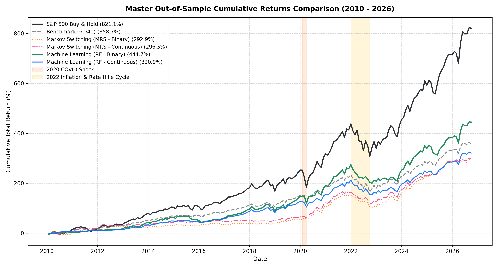
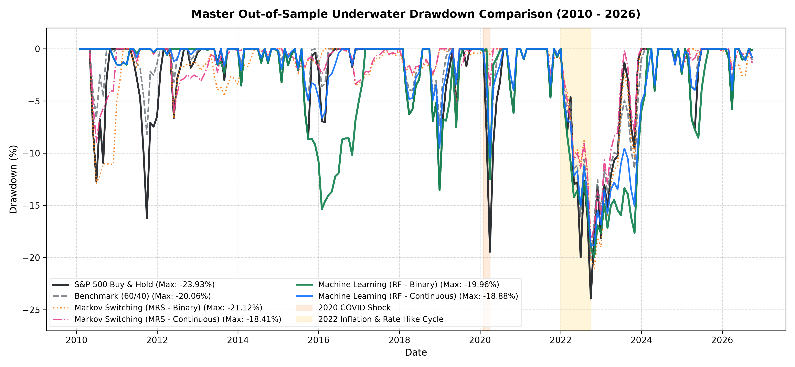
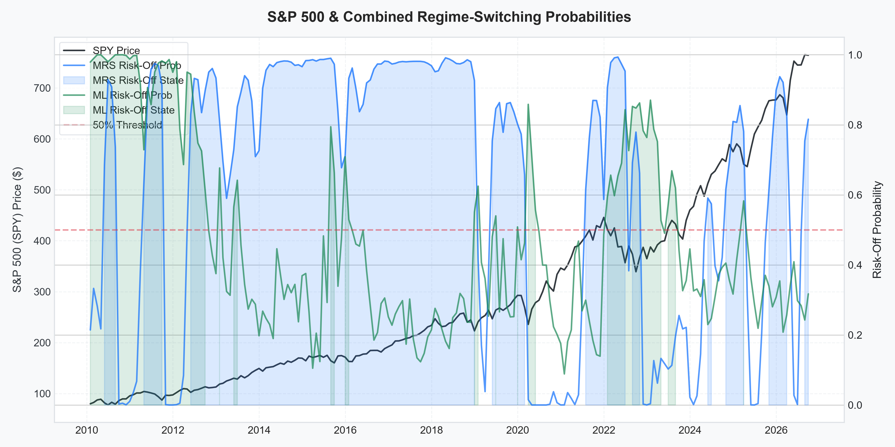
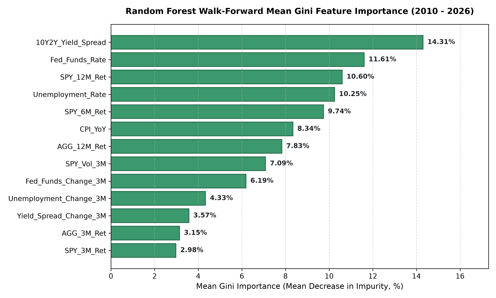

# Macro-Driven Regime Switching: Dynamic Asset Allocation Strategy

[](https://www.python.org/downloads/)
[](https://colab.research.google.com/github/VhalahallaZ/financial-data-analysis/blob/main/notebooks/regime_analysis.ipynb)
[](https://opensource.org/licenses/MIT)

> **Course**: Financial Data Analytics (FDA)  
> **Repository**: [https://github.com/VhalahallaZ/financial-data-analysis](https://github.com/VhalahallaZ/financial-data-analysis)  
> **Core Objective**: Develop, backtest, and evaluate quantitative dynamic tactical asset allocation strategies between U.S. Large-Cap Equities (**SPY**) and Core Aggregate Fixed Income (**AGG**) using macroeconomic and econometric regime signals.

---

## 📌 Executive Overview

Traditional static asset allocation strategies—most notably the balanced **60/40 Equity-Bond portfolio**—rely on a persistent negative correlation between equities and fixed income. However, during systemic liquidity panics and monetary transitions (such as the 2008 Global Financial Crisis and the 2022 Fed rate-hiking shock), **stock-bond correlations can break down**, leaving capital exposed to severe drawdowns.

This research builds an institutional-grade, point-in-time quantitative framework that dynamically rotates capital between **SPY** and **AGG**. We evaluate two distinct regime-detection methodologies against passive benchmarks:
1. **Traditional Econometric Approach**: A 2-state **Markov Regime-Switching (MRS)** model using the Hamilton filter on equity returns and realized market volatility.
2. **Machine Learning Approach**: An expanding walk-forward **Random Forest (RF)** classifier utilizing 13 macroeconomic, term-structure, and momentum features to predict forward downside market distress without look-ahead bias.

---

## 📊 Master Performance Summary (Out-of-Sample: 2010–2026)

All backtests incorporate **Total-Return adjustment (`auto_adjust=True`)**, realistic **10 bps (0.10%) transaction fees per traded turnover**, and **organic monthly intra-month weight drift**.

| Strategy | Cumulative Total Return | Annualized Return (CAGR) | Annualized Volatility | Sharpe Ratio ($R_f=0\%$) | Sortino Ratio | Maximum Drawdown | Calmar Ratio |
| :--- | :---: | :---: | :---: | :---: | :---: | :---: | :---: |
| **S&P 500 Buy & Hold** | **821.14%** | **14.18%** | 14.34% | 0.988 | 0.917 | -23.93% | **0.592** |
| **Benchmark (60/40 SPY/AGG)** | 358.74% | 9.52% | 9.20% | 1.035 | 0.980 | -20.06% | 0.475 |
| **MRS - Binary Switching** | 292.90% | 8.51% | 9.09% | 0.937 | **1.040** | -21.12% | 0.403 |
| **MRS - Continuous Allocation** | 296.46% | 8.57% | **8.44%** | 1.015 | **1.107** | **-18.41%** | 0.466 |
| **Machine Learning (RF - Binary)** | **444.73%** | **10.65%** | 11.10% | 0.959 | 0.946 | **-19.96%** | **0.534** |
| **Machine Learning (RF - Continuous)** | 320.94% | 8.96% | **8.45%** | **1.060** | **1.022** | **-18.88%** | 0.474 |

### 🔍 Key Findings:
1. **Risk-Adjusted Quality**: **ML Continuous Allocation** delivers the highest overall **Sharpe ratio (1.060)** and lowest annualized volatility (**8.45%**), outperforming the static 60/40 benchmark (1.035).
2. **Wealth Accumulation & Calmar**: **ML Binary Switching** compounds capital to **444.73%** (vs. 358.74% for 60/40 and 292.90% for MRS), achieving the highest **Calmar ratio (0.534)** among all switching strategies.
3. **Downside Tail Mitigation**: Both MRS Continuous (**1.107**) and ML Continuous (**1.022**) achieve **Sortino ratios $> 1.0$**, confirming that regime-switching models effectively truncate harmful downside volatility.

---

## 🗂️ Data Sources & Date Range

### 1. Ingestion Universe
| Asset / Series | Ticker / ID | Source | Native Frequency | Description & Role |
| :--- | :--- | :--- | :--- | :--- |
| **SPY** | `SPY` | Yahoo Finance | Daily | S&P 500 ETF Trust (Equity Growth Engine) |
| **AGG** | `AGG` | Yahoo Finance | Daily | iShares Core U.S. Aggregate Bond ETF (Defensive Anchor) |
| **VBMFX** | `VBMFX` | Yahoo Finance | Daily | Vanguard Total Bond Market Index (Historical proxy for AGG pre-09/2003) |
| **10Y-2Y Spread** | `T10Y2Y` | FRED (St. Louis Fed) | Daily | 10-Year minus 2-Year Treasury Yield Spread (Term Structure) |
| **Fed Funds Rate** | `FEDFUNDS` | FRED (St. Louis Fed) | Daily / Monthly | Effective Federal Funds Policy Rate |
| **CPI Inflation** | `CPIAUCSL` | FRED (St. Louis Fed) | Monthly | Consumer Price Index for All Urban Consumers |
| **Unemployment** | `UNRATE` | FRED (St. Louis Fed) | Monthly | U.S. Civilian Unemployment Rate |

### 2. Date Ranges
* **Full Ingestion Window**: **January 1, 1998 to September 30, 2026** (includes 2-year initialization buffer for 12-month returns).
* **Model Feature Matrix Window**: **January 31, 2000 to September 30, 2026** (321 monthly observations).
* **Startup Training Window**: **January 2000 to December 2009** (120 months / 10 years).
* **Out-of-Sample Evaluation Window**: **January 2010 to September 2026** (201 months of clean, out-of-sample forward walk).

### 3. Data Hygiene & Look-Ahead Bias Elimination
* **Corporate Actions & Dividends**: Fetched with `auto_adjust=True` to eliminate artificial price drops on ex-dividend and coupon dates.
* **Proxy-Stitching**: AGG launched in September 2003. To evaluate the 2000–2002 Dot-Com crash, AGG prices before September 2003 are stitched with VBMFX using the first available price ratio ($k = \text{AGG}_0 / \text{VBMFX}_0$).
* **Point-in-Time Publication Lag Adjustment**: Bureau of Labor Statistics (BLS) reports for CPI and Unemployment are released with a 1–2 week lag (e.g., September figures are published in mid-October). To strictly eliminate look-ahead bias, an explicit 1-month lag (`.shift(1)`) is applied to `CPI_Inflation_Index` and `Unemployment_Rate`.

### 4. Raw Data Export (`Dynamic asset allocation raw data.csv`)
The raw dataset is consolidated in [`Dynamic asset allocation raw data.csv`](Dynamic%20asset%20allocation%20raw%20data.csv).  
Because market series are daily trading days while economic surveys are monthly, the raw file performs a **full calendar outer join (`how='outer'`) on `Date`**. This preserves the exact, unaltered values and native timestamps from both Yahoo Finance and FRED without artificial imputation.

---

## 🚀 Steps to Reproduce the Analysis

You can reproduce the complete analysis either **online in Google Colab** (zero local installation) or **locally via Python CLI**:

### Method A: Run Online in Google Colab (Recommended)
1. Click the **Open In Colab** badge above or visit:  
   [`notebooks/regime_analysis.ipynb`](notebooks/regime_analysis.ipynb)
2. In Google Colab, select **Runtime > Run all** (`Ctrl + F9`).
3. The notebook will automatically install dependencies, download market and macro data, run the walk-forward models, generate all master comparison plots, and display the performance summary table.

### Method B: Run Locally via Python CLI

#### 1. Clone the repository
```bash
git clone https://github.com/VhalahallaZ/financial-data-analysis.git
cd financial-data-analysis
```

#### 2. Create and activate a virtual environment
```bash
python -m venv venv
# Windows:
venv\Scripts\activate
# Mac / Linux:
source venv/bin/activate
```

#### 3. Install dependencies
```bash
pip install -r requirements.txt
```

#### 4. Run the complete pipeline
```bash
# 1. Run Binary Dynamic Allocation System
python main.py

# 2. Run Continuous Allocation System (V2)
python main_continuous.py

# 3. Generate Master All-in-One Plots (Cumulative Returns & Underwater Drawdowns)
python plot_master_comparison.py

# 4. (Optional) Run Exploratory Data Analysis Suite
python eda_analysis.py
```

All generated charts will be saved to the `plots/`, `plots_continuous/`, and `plots_eda/` directories.

---

## 📈 Visualizations & Master Charts

| Master Cumulative Returns Comparison | Master Underwater Drawdown Comparison |
| :---: | :---: |
|  |  |

| Combined Regime Switching Probabilities (MRS vs. ML) | Walk-Forward Gini Feature Importance Ranking |
| :---: | :---: |
|  |  |

---

## 📁 Repository File Structure

```
├── Dynamic asset allocation raw data.csv  # Consolidated raw daily & monthly inputs (outer join)
├── FDA Final Project Report Guideline.pdf # Academic course rubric
├── README.md                              # Complete research documentation & setup guide
├── requirements.txt                       # Version-pinned Python dependencies
├── main.py                                # Main pipeline for binary dynamic allocation
├── main_continuous.py                     # Pipeline for continuous dynamic allocation (V2)
├── plot_master_comparison.py              # Generates master 6-strategy comparison plots & table
├── eda_analysis.py                        # Exploratory Data Analysis script
├── master_performance_summary.csv         # Computed performance metrics across all 6 strategies
├── gini_feature_importance.csv            # Computed mean Gini feature importance ranking
├── notebooks/
│   └── regime_analysis.ipynb              # Self-contained Google Colab reproducible notebook
├── plots/                                 # Binary allocation plots, combined regimes, & master figures
├── plots_continuous/                      # Continuous allocation plots
├── plots_eda/                             # Exploratory Data Analysis charts (4 investigations)
└── src/
    ├── __init__.py
    ├── data_loader.py                     # Total return adjustment, VBMFX stitching, publication lag
    ├── models.py                          # Markov Regime Switching & Walk-Forward Random Forest
    ├── backtester.py                      # Simulation engine (10 bps turnover friction & drift)
    └── visualizer.py                      # Publication-grade chart generation functions
```

---

## 📜 License & Citation
This project is licensed under the MIT License - see the [LICENSE](LICENSE) file for details.  
Academic research conducted for the Financial Data Analytics (FDA) curriculum.
